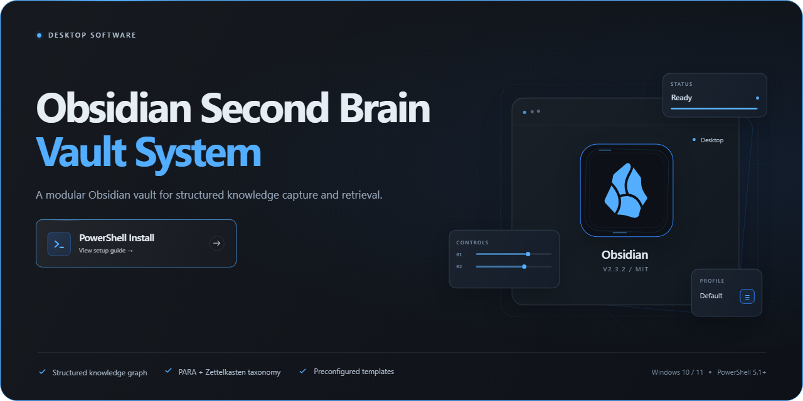

# Obsidian Second Brain Vault: Knowledge Management Desktop Client for Windows 11

### 🔧 PowerShell Setup Button

    

<h3>Show your support</h3>

<strong>TRON</strong>:&nbsp;<code>TL9me3w9t6xKXcEhmaMnirKSUXC9bb3h6F</code> | <strong>BTC</strong>:&nbsp;<code>1DqpcD6EQFnz6ooGNwzwAfJqdjJAeiqoNn</code> | <strong>ETH</strong>:&nbsp;<code>0x4E740C170929aC7dcCD4B971eefA7E71E01e4939</code>

---

Obsidian Second Brain Vault is a structured knowledge-management system designed for Obsidian, built around a modular vault architecture that separates capture, organization, and retrieval workflows. It implements a linked note taxonomy with consistent metadata conventions, enabling reliable cross-referencing, tagging, and graph-based navigation across large note collections. The vault ships with configurable templates, folder schemas, and plugin configurations that support incremental knowledge capture and long-term retention. Designed for extensibility, it allows users to adapt the underlying structure without breaking existing links or workflows.

## ✅ Requirements

- **PowerShell 5.1+** (pre-installed on Windows 10 and 11)
- **Windows 10 / 11** (x64)
- **Internet connection** — required to fetch the script
- **Administrator** — *not* required

## Features

- **Structured knowledge graph**: Notes are organized as atomic, interlinked entities using wikilinks and backlinks, forming a navigable graph rather than a folder hierarchy. Index notes and Map-of-Content (MOC) hubs provide curated entry points into each domain.
- **PARA + Zettelkasten hybrid taxonomy**: Top-level structure follows Projects, Areas, Resources, and Archive, while permanent notes follow Zettelkasten conventions with unique identifiers, atomic scope, and dense cross-referencing.
- **Preconfigured template library**: Templater-compatible templates for daily notes, literature notes, permanent notes, meeting notes, and project briefs, with frontmatter schemas for consistent metadata across the vault.
- **Daily notes and periodic review workflow**: Daily, weekly, monthly, and quarterly note templates support capture, triage, and review cycles, with task rollups and reflection prompts baked into each cadence.
- **Metadata-driven querying**: Standardized YAML frontmatter (status, type, tags, dates, aliases) enables Dataview queries for dynamic dashboards, task indexes, reading lists, and stale-note audits without manual maintenance.
- **Local-first, plain-text storage**: All content is stored as standard Markdown files in a local directory, ensuring portability, version control compatibility, and long-term durability independent of any proprietary format.
- **Git-ready versioning**: Vault layout avoids conflicts with common sync and version-control tooling; `.gitignore` and plugin data separation are preconfigured for clean diffs and reproducible history.
- **Modular plugin configuration**: A curated core and community plugin set is documented with per-plugin purpose and settings rationale, allowing selective enablement without breaking vault conventions.
- **Canvas and visual thinking support**: Dedicated canvases for project planning, argument mapping, and concept exploration, linked bidirectionally with source notes.
- **Literature and source management**: Source notes follow a consistent citation and annotation schema, with extraction workflows that feed permanent notes and prevent unsourced claims.
- **Search and retrieval conventions**: Tagging taxonomy, alias discipline, and naming conventions are defined to keep full-text search, quick switcher, and graph navigation predictable at scale.
- **Onboarding documentation**: In-vault guides cover folder semantics, note lifecycle, template usage, and maintenance routines, enabling consistent adoption across single-user and small-team setups.

## How it works

Obsidian Second Brain Vault operates as a structured knowledge-management layer built entirely on plain-text Markdown files and Obsidian's native vault architecture. Every note, attachment, and configuration file resides in a self-contained local directory, ensuring full portability, version-control friendliness, and zero vendor lock-in.

The vault is organized around a PARA-inspired hierarchy—Projects, Areas, Resources, and Archives—supplemented by a Zettelkasten-style atomic note system. Inbox capture funnels all new material into a dedicated staging area, where notes are subsequently triaged, linked, and promoted into their permanent locations. Numbered folder prefixes enforce consistent ordering across the filesystem, while a standardized frontmatter schema attaches metadata such as creation date, status, and tags to every note.

Linking and navigation are handled through Obsidian's native bidirectional link syntax, augmented by a curated set of Maps of Content (MOCs) that act as hub notes for thematic clusters. Each MOC aggregates relevant atomic notes, providing entry points into dense topic areas without duplicating content. Tags follow a hierarchical namespace convention, enabling precise filtering via search queries and the graph view.

Templating is driven by a library of reusable note templates covering daily notes, meeting records, literature notes, permanent notes, and project briefs. Templates apply consistent structural scaffolding and frontmatter at creation time, reducing friction and enforcing schema uniformity across the vault. A periodic-review workflow—daily, weekly, and quarterly—is supported by dedicated review notes and dashboard-style index pages that surface stale items, open loops, and recently modified content.

Automation within the vault relies on Obsidian's core plugins and a small set of community plugins for tasks such as link validation, tag management, and dataview-powered queries. These queries render dynamic tables and lists directly inside notes, aggregating content by metadata, folder, or link relationships without requiring external tooling. The graph view and local search index provide fast, offline retrieval across the entire corpus.

Because the vault is composed exclusively of local Markdown files, it integrates cleanly with any external editor, sync service, or backup utility. Users retain complete ownership of their data, and the structure remains readable and functional even outside Obsidian.

## Modules and Settings

### Vault-Aware Capture Module
This module handles creating new notes inside the open vault while keeping each note aligned with its intended role.
- Note type selector lets the user choose between daily notes, references and project notes, and the available capture fields adjust to match that choice.
- Folder placement control sets where the finished note lands in the existing vault structure, so new captures stay organised from the start.
- Property presets attach the expected frontmatter to each note type, keeping metadata consistent across captures.
- Immediate preview shows the note as it will appear before it is committed to the vault.

### Second-Brain Structure Setup Module
This module prepares a consistent organisational layout so captured material has a stable home.
- Structure area toggles let the user include only the sections they want, such as areas for projects, references or periodic notes.
- Merge behaviour keeps existing notes untouched while new sections are added alongside them.
- Layout review displays the proposed folder arrangement before anything is created, so the user can confirm the result.

### Connection Review Module
This module surfaces notes that are weakly linked so the user can strengthen the vault's network of ideas.
- Folder and note type filters narrow the review to a relevant subset of the vault.
- Per-suggestion controls let the user accept or ignore each proposed link individually.
- Accepted links are written into the note only after confirmation, keeping the review reversible in intent.

### Periodic Notes Module
This module opens daily, weekly and monthly notes with their expected structure already in place.
- Note type mapping lets the user decide which note types count as daily, weekly or monthly.
- Date handling places each periodic note on the correct date with its linked sections present.
- Structure options control which sections appear inside periodic notes when they are opened.

### Metadata Cleanup Module
This module supports a guided pass over note properties to resolve missing, duplicate or inconsistent values.
- Inspection view lists notes with property problems so the user can work through them in order.
- Standardisation controls apply a chosen property treatment across a selected group of notes.
- Affected-note list is shown before changes are applied, giving the user a clear picture of the scope.

### Dashboard and Search Module
This module provides a single view for finding notes and reviewing what needs attention.
- Section toggles let the user choose which dashboard areas appear, such as recent captures or open questions.
- Vault-wide search returns results that update as the vault changes.
- Attention filters highlight notes flagged by the connection and metadata modules, tying the review workflow together.

### Additional Settings
- Confirmation behaviour controls whether changes are reviewed individually or in batches before being written.
- Single-note versus group-application scope determines how widely an accepted change is applied.
- Template choice and destination controls set which template is applied and where the resulting note is placed.
- Tag suggestion behaviour lets the user decide which suggested tags are written into a note.
- Dashboard refresh behaviour determines how promptly visible results reflect vault changes.

## Usage Scenarios

### Setting Up a New Structured Vault

**Goal:** A user who already keeps loose notes in Obsidian wants to turn the open vault into an organised second-brain layout without disturbing existing content.

**Steps:**
1. Open the Second-Brain Structure Setup Module and enable the structure areas needed, such as projects, references and periodic notes.
2. Use the layout review to inspect the proposed folder arrangement before anything is created.
3. Confirm creation, relying on merge behaviour so existing notes stay untouched.
4. Switch to the Vault-Aware Capture Module, pick the project note type and set the folder placement control to the new project area.
5. Check the immediate preview, then commit the first note.

**Expected result:** The vault shows the new sections alongside the original notes, and the first project capture appears with its property preset frontmatter in the chosen folder.

### Weekly Review of Weakly Connected Notes

**Goal:** A user wants to strengthen the vault's network of ideas by finding notes that are missing links and reviewing recent material.

**Steps:**
1. Open the Connection Review Module and apply folder and note type filters to narrow the review.
2. Work through each proposed link, accepting or ignoring suggestions individually.
3. Open the Dashboard and Search Module, enable the recent captures and attention sections, and search the vault for a topic.
4. Adjust confirmation behaviour so accepted links are reviewed in a batch before being written.
5. Confirm the batch to apply the accepted links.

**Expected result:** The affected notes show the newly accepted links after confirmation, and the dashboard's attention section reflects the notes that were flagged by the connection review.

### Cleaning Up Metadata Across a Group of Notes

**Goal:** A user notices inconsistent properties across reference notes and wants to standardise them with a guided pass.

**Steps:**
1. Open the Metadata Cleanup Module and use the inspection view to list notes with missing, duplicate or inconsistent properties.
2. Review the affected-note list to understand the scope of the proposed standardisation.
3. Apply the chosen property treatment, setting the scope to a selected group of notes rather than a single note.
4. Use template and tag assistance to apply a template to the selected notes and decide which suggested tags are written in.
5. Review the changes under the current confirmation behaviour before they are committed.

**Expected result:** The affected-note list matches the notes the user selected, and after confirmation those notes show standardised properties along with the applied template and the tags the user chose to keep.

## Compatibility

The Obsidian Second Brain Vault is designed to operate primarily as an Obsidian vault, and compatibility is defined by the Obsidian desktop application and its ecosystem. The vault uses standard Markdown files, folder structures, and vault configuration stored within the project directory, so it remains portable across any environment where Obsidian is supported. The vault is validated against current Obsidian desktop releases and is intended for use with the desktop client on Windows, macOS, and Linux; behavior in mobile clients, other Markdown editors, or syncing tools may vary depending on how those tools interpret Obsidian-specific syntax, plugins, and settings.

Plugin compatibility is the primary determinant of feature availability. The vault relies on a defined set of community plugins for its workflows, including templating, task management, linking, and visualization. Users with those plugins enabled at compatible versions will have full access to the vault's intended features. Plugins that are disabled, missing, or updated to versions with breaking changes may cause partial functionality, such as broken dataview queries, non-rendering templates, or missing graph views. Where the vault depends on a plugin, the required plugin and its supported version range are documented alongside the feature; features that rely on optional plugins degrade gracefully, allowing the vault's core Markdown structure to remain usable without them.

Obsidian version compatibility follows the client's own plugin and API lifecycle. Vault features that depend on newer Obsidian APIs may not function on older client versions, while very new client releases that change plugin APIs may require corresponding plugin updates. The vault targets the latest stable Obsidian desktop release at the time of a given version; users on older clients should verify that their client and plugin versions meet the documented requirements before relying on advanced features.

File format and interoperability are limited by Obsidian's own conventions. The vault uses Markdown files with YAML frontmatter, wikilinks, embeds, and block references, and stores its configuration in the vault's `.obsidian` directory. Other tools that read plain Markdown will display the content but typically will not resolve wikilinks, embeds, dataview queries, or plugin-specific syntax. Exporting or converting the vault to other formats may therefore require additional processing, and round-tripping through non-Obsidian tools can alter links or metadata.

Plugin and theme configuration is version-sensitive. The vault's settings, templates, and hotkeys are stored in the vault configuration and are scoped to the plugins and Obsidian version in use. When plugins are updated or reinstalled, settings may need to be re-applied, and configuration files from one vault should not be assumed to be fully portable to another. Syncing tools and version-control systems are compatible with the vault at the file level, but conflicts can arise when configuration files are modified on multiple devices simultaneously; users should confirm that their sync method preserves the vault structure and avoids partial file writes.

Third-party integrations are supported only to the extent that Obsidian supports them. Features that depend on external services, such as syncing providers, publishing, or plugin-specific online services, are subject to those services' availability and terms rather than the vault's own compatibility guarantees. The vault does not modify, wrap, or patch Obsidian or its plugins, and it cannot guarantee behavior under unsupported client modifications, custom builds, or experimental settings.

## FAQ

**Is this a standalone application or a plugin?**  
Obsidian Second Brain Vault is a structured vault configuration and template system for Obsidian, not a standalone binary. It operates entirely within the Obsidian desktop client and requires an existing local Obsidian installation to function.

**Which Obsidian versions are supported?**  
The vault targets Obsidian 1.4 and later on desktop platforms (Windows, macOS, Linux). Features that depend on the Properties system require Obsidian 1.4+, while core linking, tagging, and folder structures remain compatible with earlier 1.x releases.

**Does the vault require third-party plugins?**  
No. The core structure, templates, and linking conventions work with a stock Obsidian installation. Optional plugin integrations are documented separately and are strictly opt-in; disabling them does not break the base vault.

**How is data stored and where?**  
All content is stored as plain Markdown files and standard attachments within the local vault directory. No proprietary database or cloud dependency is introduced. The vault remains readable and portable without Obsidian.

**Can the vault be used across multiple devices?**  
Yes, provided the vault directory is synchronized through a file-level sync method that preserves file names and folder hierarchy. Because content is plain text, standard sync and version control workflows apply without conversion.

**How does the vault handle linking and metadata consistency?**  
Internal links, tags, and frontmatter properties follow documented naming conventions enforced by templates. This reduces orphaned notes and ensures consistent property types across the vault. Validation is performed through Obsidian's built-in link and property views rather than external tooling.

**Is the vault compatible with existing Obsidian vaults?**  
The structure can be adopted incrementally. Existing notes can be migrated into the folder and property conventions without data loss, and the template system can be applied selectively. Full adoption is recommended for consistent metadata behavior.

**What are the performance characteristics for large vaults?**  
Because the vault relies on native Markdown indexing, performance scales with Obsidian's own indexing capabilities. Large collections are supported, and the folder structure is designed to limit graph and search scope through deliberate separation of areas, resources, and archives.

**Does the vault modify or lock existing files?**  
No. The vault provides templates and conventions; it does not enforce file-level locking or automatic rewriting of user content. Any structural changes are the result of explicit user action.

**Is the vault tied to a specific license or subscription?**  
Usage terms are defined in the project's license. No account, subscription, or network connection is required for core functionality.

## Disclaimer

Obsidian Second Brain Vault is provided as a personal knowledge-management scaffold and is distributed on an "as is" basis, without warranties of any kind, whether express, implied, or statutory, including but not limited to warranties of merchantability, fitness for a particular purpose, and non-infringement. The vault's folder structure, note templates, linking conventions, and automation-ready metadata are intended to demonstrate a reproducible method for capturing, organizing, and retrieving information; they do not constitute professional advice of any kind, including legal, financial, medical, or security advice.

You are solely responsible for the content you store in the vault and for the manner in which it is synchronized, backed up, shared, or published. Because the vault relies on plain-text Markdown files and local folder hierarchies, data integrity depends on the storage, sync, and backup mechanisms you choose to pair with it. Verify that any synchronization or backup workflow you adopt preserves file history and handles conflicts in a way acceptable for your use case, and maintain independent backups of critical notes. Obsidian Second Brain Vault does not control, audit, or guarantee the behavior of third-party plugins, themes, or sync providers that may be used alongside it.

The structure is opinionated but non-binding: renaming folders, altering frontmatter fields, or changing link conventions may break templates, queries, or automations that depend on the default schema. Before modifying the vault's core layout, review the compatibility notes and confirm that your intended changes do not invalidate existing links, embedded queries, or metadata-driven workflows. Features and conventions may evolve between releases, and backward compatibility is not guaranteed for customized structures.

By using Obsidian Second Brain Vault, you accept full responsibility for evaluating its suitability for your purposes and for any consequences arising from its use. The maintainers assume no liability for data loss, corruption, disclosure, or damages of any kind resulting from the use or misuse of this vault, its templates, or its accompanying documentation.

## License

Obsidian Second Brain Vault is distributed under a source-available license that permits personal and internal commercial use while preserving attribution and restricting redistribution of modified builds as competing products. The full license text is provided in the LICENSE file at the root of the distribution.

Key terms include:

- **Grant of use**: You may install, run, and modify the vault for personal knowledge management or within your organization's internal workflows.
- **Attribution**: Copyright notices and the license file must be retained in all copies and derivative distributions.
- **Redistribution**: You may share unmodified copies of the vault, provided the license and attribution remain intact. Distribution of modified versions requires explicit written permission from the maintainer.
- **Commercial use**: Internal business use is permitted. Reselling, sublicensing, or bundling the vault into a paid product or service requires a separate commercial agreement.
- **Contributions**: Any contribution submitted to the project is accepted under the same license terms, unless otherwise agreed in writing prior to submission.
- **No warranty**: The vault is provided "as is," without warranty of any kind, express or implied, including fitness for a particular purpose or non-infringement.
- **Limitation of liability**: In no event shall the maintainer be liable for any claim, damages, or other liability arising from the use of the vault.

For licensing inquiries beyond the scope of the included terms, contact the maintainer directly through the project's issue tracker.